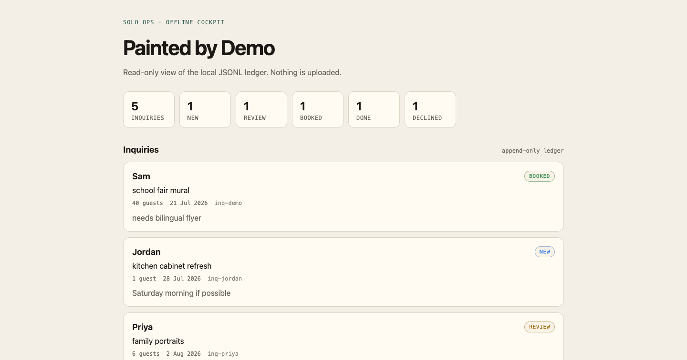

# Solo Ops

**Offline inquiry CRM for one-person service businesses. No tenant, no SaaS, no
account.**

If you run a business by yourself — painting, tutoring, repairs, photography —
the CRM options are a spreadsheet or a $40/month tool with a sales team. Solo
Ops is a single binary over an append-only JSONL ledger on your own disk.

## Install

```sh
go install github.com/nstranquist/solo-ops/cmd/solo-ops@latest
```

Requires Go 1.26+.

## Showcase



The screenshot is the read-only cockpit rendered from
`testdata/showcase.jsonl`. The names and events are fictional. Extra
shots, if any, live in [screenshots/](screenshots/).

## Usage

Track inquiries:

```sh
solo-ops inquiry-add  --ledger inquiries.jsonl --name "Sam" --event "school fair" --guests 40
solo-ops inquiry-list --ledger inquiries.jsonl
solo-ops inquiry-set  --ledger inquiries.jsonl --id inq-demo --status booked
```

Generate a policy pack — deposits, cancellations, travel, the things you get
asked the same way every time:

```sh
solo-ops policy-pack --business "Painted by Demo"
```

Render a read-only local cockpit:

```sh
solo-ops cockpit-html --ledger testdata/showcase.jsonl --business "Painted by Demo" --out cockpit.html
```

Or serve it on loopback:

```sh
solo-ops serve --ledger inquiries.jsonl --addr 127.0.0.1:8791
```

## The ledger is append-only

Status changes append; they do not rewrite history. You can read the whole file
with `cat`, keep it in a private git repo, and back it up by copying one file.
If Solo Ops disappears tomorrow, your data is still plain JSON lines you can
parse with anything.

## Your customer data stays yours

The ledger holds real people's names, contact details, and event notes, and the
generated cockpit HTML embeds those rows verbatim. Nothing is uploaded — there
is no network call in this tool. Treat the ledger and the rendered cockpit as
private artifacts; `serve` binds loopback for the same reason.

## Development

```sh
make gate           # vet + test + smoke + leak scan
make publish-ready  # run before tagging
```

`make smoke` runs every command documented above against the committed fixture,
exercises the mutating verbs against a copy, and asserts the fixture is
unchanged afterwards.

## License

MIT.
